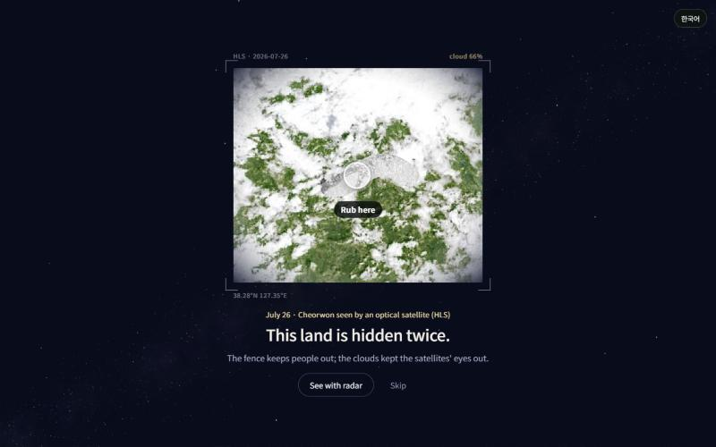
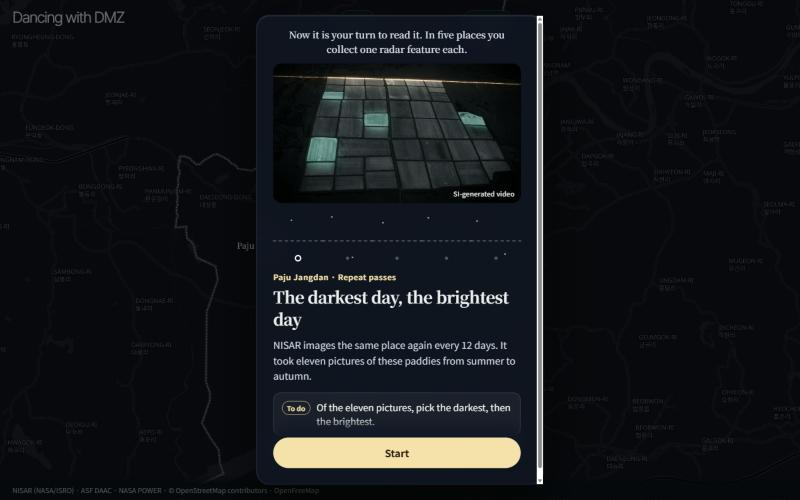
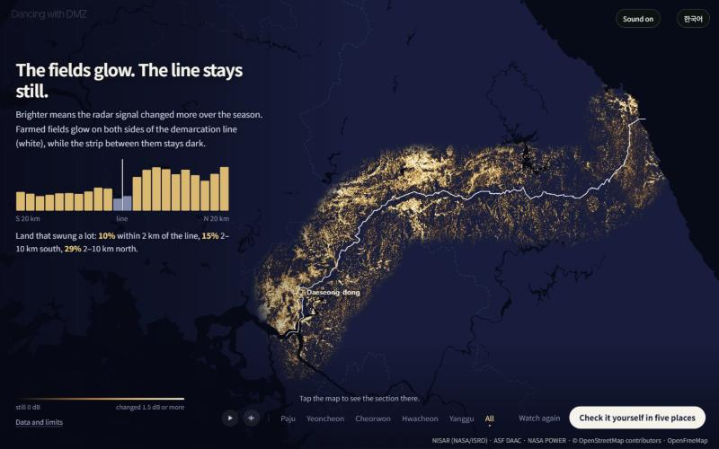

# Dancing with DMZ

### ▶ [Open the app — htjworld.github.io/dancing-with-dmz](https://htjworld.github.io/dancing-with-dmz/)

No login, no install. English: add [`?lang=en`](https://htjworld.github.io/dancing-with-dmz/?lang=en). Deployed automatically by GitHub Actions on every push to `main`.

NASA Space Apps Challenge 2026 · Challenge: **Dancing with the SARs** · Team **NASSAFY** (Seoul) · [Team page](https://www.spaceappschallenge.org/2026/find-a-team/nct/?tab=project)



## What it is

An interactive web app that teaches anyone to read radar, using a land no one can visit.

The Korean Demilitarized Zone has been closed to the public for over 70 years, and in July 2026 optical satellites were blind as well: Landsat looked at five DMZ windows 19 times and got no clear view. NISAR's L-band radar imaged the same land every 12 days, through cloud and after dark. From 11 NISAR passes (June to November 2026) we track one season of surface change across paddies, a river, forest and a mountain basin, and draw **how much each pixel changed over the season**, relative to nearby forest. Where people farm, the land glows; the unfarmed strip stays still.

The app tells one story in five steps:

1. **Opening.** A cloudy July optical image of Cheorwon. Rub it away and the NISAR image from the same month appears underneath.
2. **Night-sky film.** The view pulls back to the globe and returns to the DMZ. Eleven observations stack up as moving ridgelines, and the land that changed most turns gold.
3. **Five missions, one radar feature each.**

   | Place | Radar feature | What you do |
   |---|---|---|
   | Paju Jangdan | Radar comes back to the same place | Step through the dates and pick the darkest and brightest image of a paddy |
   | Yeoncheon Imjin River | Calm water looks black | Trace the river on the radar image |
   | Cheorwon Plain | Change maps | Overlay two dates; only land that changed takes colour |
   | Hwacheon Baegam-san | Two polarizations | Slide a curtain between HH and HV over forest and flat land |
   | Yanggu Punchbowl | Radar works at night | See which of the 11 images were taken after dark |

4. **Ending.** The five regional curves join into one line from west to east, and the line moves with the measured values, pass by pass.
5. **Explore.** The seasonal-change map as a continuous strip along the demarcation line, a cross-section chart, and an evidence panel for each region with forest-relative curves, land cover, rain and limits.

Korean and English.

| Mission card | Explore |
|---|---|
|  |  |

## How it works

No server. A Python pipeline prepares everything, and a static web app draws it in the browser.

```
NISAR L2 GCOV (ASF, ~6 GB per scene) → read only the needed pixels with HTTP range requests (tools/extract_nisar.py)
→ forest-relative seasonal change per pixel (tools/make_glow.py)
+ cloud inside each window from Landsat HLS browse images (tools/hls_window.py)
+ land cover check with ESA WorldCover 2021 (tools/landcover.py) + NASA POWER rain (tools/fetch_rain.py)
→ every number on screen comes from app/data/facts.json (tools/make_facts.py), with asserts that stop the build if a claim breaks
→ static site (app/), tested and deployed by GitHub Actions on every push to main
```

For every pixel we take HH backscatter minus the same-day forest mean (this removes scene-wide effects such as a wet day), then the spread over the season. Bright means a large seasonal change.

## Key numbers (from `app/data/facts.json`)

| | |
|---|---|
| July 2026 clear optical views (5 windows, Landsat) | 0 of 19 |
| NISAR passes with data, 2026-06-23 to 11-02 | 11 of 12 |
| Seasonal change, forest-relative, Cheorwon | paddy 2.1 dB · inside DMZ 0.7 dB · north of the line 2.0 dB |
| Seasonal change, Paju (both inside the DMZ) | farmed 2.1 dB · unfarmed 0.6 dB |
| Cropland share (ESA WorldCover 2021), Cheorwon | paddy 78.7% · inside DMZ 0.6% · north 82.9% |

## Data and sources

| Data | Use | License / terms |
|---|---|---|
| NISAR L2 GCOV (NASA/ISRO), via ASF DAAC — track 133, frames 069/070, HH/HV, 2026-06-23 to 11-02 | Seasonal change, layers, missions | NASA open data |
| HLS L30/S30 v2.0 (NASA LP DAAC), CMR metadata and browse images | Cloud over each window, opening image | NASA open data |
| NASA POWER daily precipitation | Rain before each pass | NASA open data |
| ESA WorldCover 2021 v200 | Land cover check of each zone | CC BY 4.0 |
| OpenStreetMap (demarcation line), OpenFreeMap (base map) | Map | ODbL |
| Natural Earth 110m land | Dot globe in the night-sky film | Public domain |
| MapLibre GL JS | Map rendering | BSD-3-Clause |
| Google Fonts: Noto Serif KR, Inter Tight | Typography | SIL Open Font License |
| NOAA solar position approximation | Sun height at each pass (Yanggu mission) | US Government public domain |
| Paju City survey report (2014), Gyeonggi Province DMZ guide | Daeseong-dong village inside the DMZ (explore screen) | Public reports |

Links to every source are on the [team page](https://www.spaceappschallenge.org/2026/find-a-team/nct/?tab=project) and in `submission.md`.

## Limits and what is not finished

- Glow is the size of the radar signal change, not an ecological or crop judgment.
- 10 of the 11 passes are PROVISIONAL products; the glow map is built from the app's display layers (coarser than the 30 m source).
- The pass of 2026-07-29 has no data.
- On 8/22 every zone brightened after 39 mm of rain; on 10/21 every zone brightened with almost no rain, and we do not know why.
- One season only; zones are rectangles chosen on the radar image (checked against WorldCover 2021).
- North of the line is described only as "appears to be farmland".
- The dancing line shows change in backscatter, not ground movement. The music and sky colours are staging.
- Layout on narrow phone screens has not been checked. Use a desktop or tablet browser.
- Not done yet: rebuilding the change map from the 30 m source, a second track, a second season.

## Run locally

```bash
python -m http.server 5173 --directory app   # then open http://localhost:5173
npm test                                      # logic and data checks (node --test)
```

The app needs no keys or environment variables. Only rebuilding the data from NISAR does: put an Earthdata Login token in `.env` as `EARTHDATA_TOKEN` (see `.env.example`). `.env` is never committed.

## Use of SI (AI tools)

Team members chose the problem, directed each step, ran and reviewed every script, and checked results against the data.

- **Code, data scripts, tests and documents:** Claude (Anthropic) through Claude Code. SI-generated code is covered by the tests in `app/tests` and the asserts in `tools/`.
- **Review:** OpenAI Codex, to review brainstorming notes and check sources.
- **Video:** the five short intro clips on the mission cards (`app/media/intro/*.mp4`) were generated with Higgsfield. They are illustrations of each radar feature, not data. Each clip is shown with a visible "SI-generated video" label in the app, and they contain no NASA logos, flags or mission identifiers.
- **Music:** the soundtrack is synthesized in the browser from code written with SI assistance. No SI-generated audio files are used.

All maps, curves and numbers come from NISAR and the other listed data, not from SI generation.

## License

[Apache License 2.0](LICENSE). Data and libraries keep their own licenses, listed above.

---

## 한국어

70년 넘게 일반인이 들어갈 수 없는 땅, 한반도 비무장지대(DMZ). 2026년 7월에는 빛으로 찍는 위성도 이 땅을 보지 못했다(다섯 지역을 19번 찍어 맑은 날 0번). 레이더 위성 NISAR는 구름과 밤을 가리지 않고 12일마다 같은 곳을 다시 찍었다. 이 서비스는 2026년 6~11월 11번의 NISAR 관측으로 **화소마다 한 계절 동안 얼마나 변했는지**를 빛으로 그리고, 레이더를 처음 보는 사람도 읽을 수 있게 안내한다.

흐름은 다섯 단계다. 구름 문지르기(오프닝) → 밤하늘 영상 → 다섯 미션(파주 반복 관측, 연천 표면 반사, 철원 변화 지도, 화천 편파, 양구 밤 관측) → 엔딩(다섯 곡선이 하나의 선으로 이어져 실측값대로 움직인다) → 밤하늘 둘러보기(변동 지도, 단면, 지역별 근거).

## 실행

```bash
python -m http.server 5173 --directory app
```

## 데이터 다시 만들기

```bash
pip install -r requirements.txt
python tools/extract_nisar.py --list        # 사용하는 NISAR 장면 목록
python tools/extract_nisar.py --workers 4   # 다섯 지역 창을 원격으로 읽어 data/cache 에 저장
python tools/preview_regions.py             # 구역을 고르기 위한 미리보기 그림(data/cache/_preview)
python tools/make_regions.py                # tools/zones.py 의 구역별 시계열 -> app/data/regions.json
python tools/make_layers.py                 # 지도에 올릴 흑백 레이더 영상 -> app/data/layers/
python tools/make_river.py                  # 연천 강 위의 점과 날짜별 어두운 비율 -> app/data/river.json
python tools/fetch_rain.py                  # NASA POWER 강수 -> app/data/rain.json
python tools/make_dmz.py                    # OpenStreetMap 군사분계선 -> app/data/dmz.geojson
python tools/make_glow.py                   # 계절 변동 지도(숲 대비) -> app/data/glow/, glow.json
python tools/hls_cloud.py                   # HLS 광학 구름량(NASA CMR) -> data/hls_clouds.json
python tools/hls_window.py                  # 다섯 지역 창 안 구름(Landsat 미리보기) -> data/hls_window.json
python tools/landcover.py                   # 구역 토지피복(ESA WorldCover 2021) -> app/data/landcover.json
python tools/make_facts.py                  # 화면·발표 공통 숫자 -> app/data/facts.json
python tools/make_opening.py                # 7월 철원 HLS 광학(구름) + 같은 달 NISAR -> app/data/opening/, opening.json
python tools/make_paddy_curve.py            # 내포리 논의 물 찬 화소 비율 곡선 -> app/data/paddy_curve.json
python tools/make_ridges.py                 # 밤하늘 영상의 물결 선 -> app/data/ridges.json
python tools/make_section.py                # 둘러보기의 띠 단면 숫자 -> app/data/section.json
```

연속 관측 띠(`app/data/corridor/`)는 `tools/corridor/`의 스크립트로 만든다. 형식은 `interface.md` 2-1a.

Earthdata Login 토큰을 `.env` 의 `EARTHDATA_TOKEN` 에 넣어야 한다(`.env.example` 참고). `.env` 는 저장소에 올리지 않는다.

## 데이터와 출처

- NISAR L2 GCOV (NASA/ISRO), ASF DAAC 제공. 궤도 133, 프레임 069(띠는 070으로 빈 곳을 채움), HH/HV 후방산란.
- 2026-06-23 ~ 11-02 의 11개 통과(7월 29일 통과는 자료가 없다). 11월 2일 장면만 정식판(V1) 컬렉션이고 나머지는 PROVISIONAL 이다. 처리 버전이 달라 값의 기준이 조금 다를 수 있다.
- 강수: NASA POWER 일 강수량(PRECTOTCORR). 약 50 km 격자라 파주와 연천은 같은 값이다.
- 군사분계선: © OpenStreetMap contributors (ODbL). 표시용 개략 기하다.
- 배경 지도: OpenFreeMap, © OpenStreetMap contributors.
- 지구본 점: Natural Earth 110m. 글꼴: Noto Serif KR, Inter Tight (Google Fonts).

## AI(SI) 사용

코드·데이터 스크립트·테스트·문서는 Claude Code(Anthropic)로, 검토는 OpenAI Codex로 했다. 미션 소개 영상 다섯 개(`app/media/intro/`)는 Higgsfield로 생성했고 화면에 "SI-generated video" 표시가 나온다. 음악은 브라우저에서 코드로 합성한다. 지도·곡선·숫자는 모두 NISAR 등 실제 자료에서 나온다.

## 해석의 한계

- 레이더 신호 변화의 원인은 "가능한 설명"으로만 적는다. 홍수·수확·생태 상태를 확정하지 않는다.
- 선의 춤은 후방산란 값의 변화를 그린 것이며, 땅이 실제로 움직인 것(지표 변위)이 아니다.
- 구역은 팀이 영상에서 고른 사각형이다. ESA WorldCover 2021로 토지피복을 대조했다(`app/data/landcover.json`, 2021년 지도).
- 좁은 휴대폰 화면 배치는 확인하지 않았다.

## 라이선스

Apache License 2.0 (`LICENSE`).
